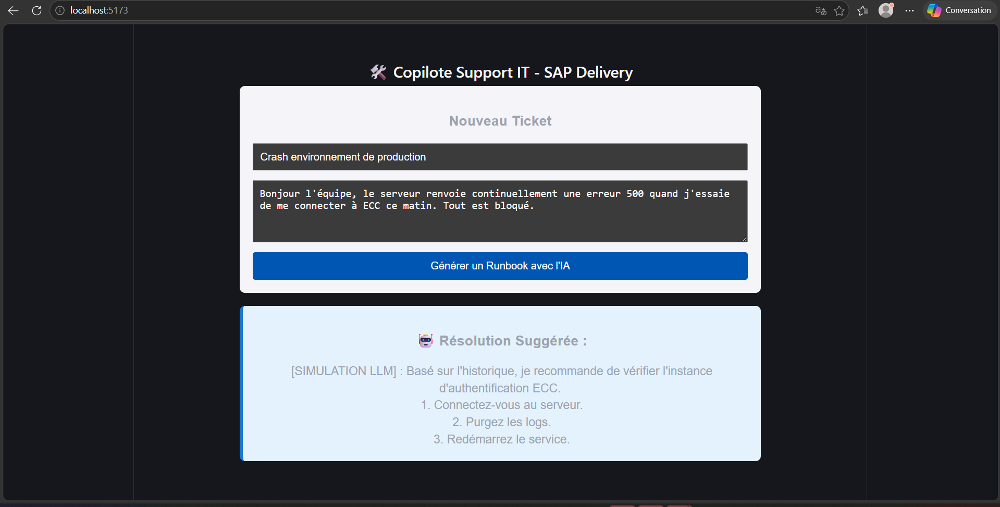

# Copilote Support IT (SAP) — retrouver comment un incident similaire a déjà été résolu

Ce projet sert à **aider un technicien du support informatique** : il décrit un incident, et l'outil retrouve les anciens incidents qui lui ressemblent, avec la solution qui avait été appliquée, pour préparer une procédure de résolution.

> **État du projet : preuve de concept (PoC).** La recherche des incidents similaires fonctionne, mais **la réponse affichée est pour l'instant un texte simulé, toujours le même** : aucune IA de rédaction n'est encore branchée, faute de clé Mistral. Les « anciens tickets » sont 4 exemples fictifs écrits dans le code, en attendant un véritable historique (voir « Indexer un historique réel »).
>
> L'accès est en revanche **authentifié** : l'interface demande un identifiant et un mot de passe, et `POST /copilot/ask` refuse toute requête sans jeton valide.



---

## À quoi ça sert

Dans une entreprise, quand un logiciel tombe en panne, les employés ouvrent un **ticket** (une demande d'aide) auprès du support informatique. Ici, le logiciel concerné est **SAP**, un logiciel de gestion très répandu dans les grandes entreprises (comptabilité, achats, ressources humaines…).

Souvent, le même type de panne est déjà arrivé et a déjà été résolu. Mais retrouver le bon ancien ticket prend du temps, surtout si on ne connaît pas les mots exacts utilisés à l'époque.

Exemple : un employé écrit « la page charge dans le vide puis affiche un code 500 ». L'outil retrouve un ancien ticket « Impossible de se connecter à l'environnement de PROD, code erreur 500 », résolu par « Redémarrage de l'instance d'authentification et purge des logs ».

C'est comme un collègue expérimenté qui dirait : « Ça me rappelle un cas de l'an dernier, voilà ce qu'on avait fait. »

Le résultat visé est un **runbook** : une procédure de résolution écrite étape par étape.

---

## Comment ça marche

L'application est composée de trois programmes qui se parlent :

1. **L'interface** (dans le navigateur) : un formulaire avec le sujet et la description de l'incident.
2. **L'orchestrateur** : un programme intermédiaire qui reçoit la demande, la transmet au moteur de recherche, puis **enregistre** la question et la réponse dans un historique.
3. **Le moteur de recherche** : il retrouve les anciens tickets les plus proches et prépare le texte destiné à l'IA.

### Étape 1 — Préparer la base de connaissances (une seule fois)

1. Les anciens tickets (sujet, description, solution) sont **nettoyés** : passage en minuscules, suppression de la ponctuation.
2. Le sujet et la description de chaque ticket sont transformés en **embedding** : une liste de nombres qui représente le *sens* du texte. Deux textes qui parlent de la même chose obtiennent des listes de nombres proches, même s'ils n'utilisent pas les mêmes mots.
3. Ces embeddings sont rangés dans une **base vectorielle** : une base de données spécialisée qui sait retrouver rapidement les textes au sens le plus proche.

### Étape 2 — Traiter un nouvel incident

1. Le technicien saisit le sujet et la description dans l'interface.
2. Le moteur cherche les **2 anciens tickets les plus proches** dans la base vectorielle.
3. Il construit un **prompt** (le texte d'instructions destiné à une IA) qui contient : le rôle attendu (« assistant support SAP »), les 2 anciens tickets et leur solution, puis le nouveau problème.
4. Ce prompt est prévu pour être envoyé à un **LLM** (*Large Language Model*, « grand modèle de langage ») : un programme d'IA capable de rédiger du texte, comme celui derrière ChatGPT. Ici, c'est l'API **Mistral** qui est utilisée. **Sans clé API, l'étape est simulée** : le code renvoie un texte d'exemple fixe, marqué `[SIMULATION LLM]`.
5. L'orchestrateur enregistre le ticket et la réponse dans une petite base de données locale, puis renvoie la réponse à l'interface.

Cette méthode, qui consiste à **chercher** d'abord des informations utiles puis à les **donner** à l'IA pour qu'elle rédige sa réponse, s'appelle le **RAG** (*Retrieval-Augmented Generation*, « génération augmentée par la recherche »).

---

## Résultat / ce qu'on obtient

- Une page web avec un formulaire « Nouveau ticket » et un bouton **« Générer un Runbook avec l'IA »**.
- Une zone **« Résolution suggérée »** qui affiche la réponse. Aujourd'hui, c'est toujours le même texte simulé (voir la capture ci-dessus).
- Un **historique** des demandes enregistré dans une base de données locale (fichier `database.sqlite`, créé au premier lancement, non versionné).
- Côté moteur, la réponse technique contient aussi le **prompt complet** construit avec les anciens tickets retrouvés (champ `prompt_utilise`) : c'est là qu'on peut vérifier que la recherche a trouvé les bons tickets.

Pour obtenir de vraies réponses, il reste deux choses à fournir : un **véritable historique de tickets** (voir « Indexer un historique réel ») et une **clé Mistral** (voir « Pour les développeurs »).

---

## Pour les développeurs

### Architecture

```
┌──────────────────────┐   POST /copilot/ask   ┌──────────────────────┐   POST /ask-copilot   ┌──────────────────────┐
│  1-frontend-react    │ ────────────────────► │  2-backend-nestjs    │ ────────────────────► │  ai-service-python   │
│  React + Vite        │ ◄──────────────────── │  NestJS + TypeORM    │ ◄──────────────────── │  FastAPI + ChromaDB  │
│  localhost:5173      │                       │  localhost:3000      │                       │  localhost:8000      │
└──────────────────────┘                       └──────────┬───────────┘                       └──────────────────────┘
                                                          │
                                                          ▼
                                               database.sqlite (SQLite)
                                               table tickets_historique
```

- **Frontend** (`1-frontend-react/src/App.jsx`) : formulaire sujet + description, appel `axios` à `${VITE_API_URL}/copilot/ask` (`http://localhost:3000` par défaut), affichage de `resolution_suggeree`.
- **Orchestrateur** (`2-backend-nestjs`) : route `POST /copilot/ask`, appel HTTP à `AI_SERVICE_URL` (`http://localhost:8000/ask-copilot` par défaut), puis sauvegarde (`sujet`, `description`, `resolution_ia`, `date_creation`) dans la table `tickets_historique` de `database.sqlite` via TypeORM (synchronisation du schéma désactivée par défaut, activable en développement avec `DB_SYNCHRONIZE=true`). CORS restreint aux origines de `ALLOWED_ORIGINS` (méthode `POST`, en-tête `Content-Type`). Port configurable avec la variable `PORT` (3000 par défaut).
- **Moteur IA** (`ai-service-python`) :
  - `data_prep.py` : jeu de 4 tickets fictifs (`INC001` à `INC004`) défini dans le code, nettoyage du texte et création de la colonne `Contexte_Pour_Embedding` (`"sujet: ... | description: ..."`) ;
  - `build_vector_db.py` : indexation dans ChromaDB (collection `sap_tickets`, dossier `./chroma_db`) avec la fonction d'embedding par défaut de ChromaDB (modèle `all-MiniLM-L6-v2`, téléchargé au premier lancement) ; l'ID du ticket et la résolution sont stockés en métadonnées ;
  - `rag_pipeline.py` : recherche des 2 tickets les plus proches (`n_results=2`) et construction du prompt. La connexion à ChromaDB est ouverte au premier appel (pas à l'import) et la requête est nettoyée par la même fonction que les tickets indexés (`data_prep.build_embedding_context`) ;
  - `main.py` : API FastAPI, route `POST /ask-copilot`. Appelle le LLM via `llm.py` ; la réponse est simulée si `MISTRAL_API_KEY` n'est pas défini.
  - `llm.py` : appel HTTP à l'API Mistral (`mistral-small-latest` par défaut, `temperature=0.3`). Erreur Mistral → réponse `502` côté Python. Base vectorielle absente → `503` ; toute autre erreur → `500` avec un message générique (le détail est journalisé côté serveur).

### Format de l'API Python

Requête `POST /ask-copilot` :

```json
{ "sujet": "Erreur 500 sur la prod SAP", "description": "Impossible d'accéder à SAP ECC ce matin." }
```

Réponse :

```json
{
  "status": "success",
  "sujet_analyse": "...",
  "resolution_suggeree": "[SIMULATION LLM] : ...",
  "simulated": true,
  "prompt_utilise": "..."
}
```

`simulated` vaut `true` quand aucune clé Mistral n'est définie (texte d'exemple). Avec `ALLOW_SIMULATION=false`, le service répond `503` à la place. NestJS transmet `simulated` mais jamais `prompt_utilise`, et traduit les pannes du service IA en `503` (injoignable ou non prêt), `504` (délai dépassé) ou `502` (échec ou réponse inattendue).

Documentation interactive : http://localhost:8000/docs

### Stack technique

| Rôle | Outil |
|---|---|
| Interface | `React 19` + `Vite 8` + `axios` |
| Orchestrateur | `NestJS 11` + `@nestjs/axios` + `TypeORM` + `sqlite3` |
| Moteur IA | `FastAPI` + `Uvicorn` + `ChromaDB` + `pandas` |
| LLM (optionnel) | API Mistral (via `httpx`) |
| Tests | `pytest` + `httpx` (Python), `jest` (NestJS) |

### Prérequis

- **Node.js** 20.19 ou plus récent (ou 22.12+) : exigence de Vite 8 ; NestJS 11 demande au minimum Node 20.
- **Python** 3.9 ou plus récent.
- Une connexion Internet au premier lancement (téléchargement du modèle d'embedding par ChromaDB).

### Installation

#### Moteur IA (Python)

```bash
cd ai-service-python
python -m venv venv
# Windows :
venv\Scripts\activate
# macOS / Linux :
source venv/bin/activate

pip install -r requirements.txt        # service FastAPI + tests
pip install -r requirements-data.txt   # en plus, pour construire la base vectorielle
```

> Deux fichiers de dépendances : `requirements.txt` suffit pour lancer le service et les tests ; `requirements-data.txt` (qui inclut le premier) ajoute `pandas`, utilisé uniquement par les scripts d'indexation `data_prep.py` / `build_vector_db.py`. Le service n'importe pas `pandas` : il reste plus léger à déployer.

Générer la base vectorielle (obligatoire avant le premier lancement, puis à chaque modification des tickets) :

```bash
python build_vector_db.py
```

##### Indexer un historique réel

Par défaut, l'indexation utilise les 4 tickets d'exemple de `data_prep.py` et **l'annonce dans la console** (`ATTENTION : aucun historique reel`). Pour indexer de vraies données, déposez un fichier `tickets.csv` dans `ai-service-python/` (ou pointez `TICKETS_CSV` vers le vôtre), puis relancez `python build_vector_db.py`.

Colonnes requises :

| Colonne | Rôle |
|---|---|
| `Ticket_ID` | Identifiant unique. Sert de clé de mise à jour (`upsert`) : un doublon est écarté. |
| `Sujet` | Titre court de l'incident. Vectorisé. |
| `Description` | Description détaillée. Vectorisée avec le sujet. |
| `Resolution` | Ce qui a résolu l'incident. C'est ce que le LLM reçoit comme exemple. |

```csv
Ticket_ID,Sujet,Description,Resolution
INC100,Export FI bloque,Le batch de nuit echoue,Relance du job RSBTCDEL
```

Les lignes sans identifiant, sans résolution, ou sans sujet **ni** description sont écartées (le décompte est affiché). Si le fichier existe mais que ses colonnes ne correspondent pas, le script **échoue** au lieu de se replier en silence sur les exemples : un index de données fictives présenté comme réel serait pire qu'une erreur.

Le fichier contient des données internes : il est **ignoré par git**.

La base `chroma_db/` est **générée localement et n'est pas versionnée** (ignorée par git). Elle est créée par défaut dans `ai-service-python/chroma_db/`, quel que soit le dossier courant, ou dans le dossier indiqué par `CHROMA_DB_PATH`. Le script peut être relancé sans risque : les tickets existants sont mis à jour (`upsert`). Sans base, le service démarre quand même mais `POST /ask-copilot` répond `503` « Base de connaissances non initialisée ».

#### Orchestrateur (NestJS)

```bash
cd 2-backend-nestjs
npm install
```

La base SQLite `database.sqlite` (historique des demandes) est **générée localement et n'est pas versionnée**. La table `tickets_historique` est **créée automatiquement au premier démarrage** par une migration TypeORM. `DB_SYNCHRONIZE` (désactivé par défaut) ne sert plus qu'à aligner le schéma sur les entités pendant le développement :

```bash
DB_SYNCHRONIZE=true npm run start:dev        # macOS / Linux / Git Bash
$env:DB_SYNCHRONIZE="true"; npm run start:dev # PowerShell
```

Pour repartir de zéro : arrêter l'orchestrateur, supprimer `database.sqlite`, puis relancer de la même façon.

##### Clé de signature des jetons (obligatoire)

L'orchestrateur **refuse de démarrer** sans `JWT_SECRET` d'au moins 32 caractères : un secret faible ou codé en dur rendrait tous les jetons forgeables. Générez-en un :

```bash
node -e "console.log(require('crypto').randomBytes(48).toString('base64url'))"
```

Puis définissez-le dans l'environnement du shell (NestJS ne charge pas `.env` automatiquement) :

```bash
export JWT_SECRET="la-valeur-generee"            # macOS / Linux / Git Bash
$env:JWT_SECRET="la-valeur-generee"              # PowerShell
```

##### Créer un compte technicien

Aucun compte n'existe au départ : l'interface serait inutilisable. La table `utilisateurs` est créée par une migration au premier démarrage, puis :

```bash
NOUVEAU_MOT_DE_PASSE="un-mot-de-passe-de-12-caracteres-minimum" npm run utilisateur:creer -- technicien
```

En PowerShell :

```powershell
$env:NOUVEAU_MOT_DE_PASSE="un-mot-de-passe-de-12-caracteres-minimum"
npm run utilisateur:creer -- technicien
```

Le mot de passe passe par la variable `NOUVEAU_MOT_DE_PASSE` (ou l'entrée standard), **jamais en argument** : un argument serait visible dans l'historique du shell et dans la liste des processus. Il est stocké sous forme d'empreinte `bcrypt` (coût 12), jamais en clair. Pour changer le mot de passe d'un compte existant, ajoutez `--remplacer`.

#### Interface (React)

```bash
cd 1-frontend-react
npm install
```

### Lancement (3 terminaux)

**Terminal 1 — Moteur IA**

```bash
cd ai-service-python
# activer l'environnement virtuel (ex. : venv\Scripts\activate)
python main.py
```

Service sur http://localhost:8000

**Terminal 2 — Orchestrateur**

```bash
cd 2-backend-nestjs
npm run start:dev
```

Service sur http://localhost:3000

**Terminal 3 — Interface**

```bash
cd 1-frontend-react
npm run dev
```

Interface sur http://localhost:5173 : ouvrez cette adresse dans votre navigateur.

### Variables d'environnement

| Variable | Où | Défaut | Rôle |
|---|---|---|---|
| `ALLOWED_ORIGINS` | NestJS | `http://localhost:5173` | Origines autorisées par CORS, séparées par des virgules. Le joker `*` est ignoré. |
| `AI_SERVICE_URL` | NestJS | `http://localhost:8000/ask-copilot` | URL complète du service Python (appel serveur à serveur, sans CORS). |
| `PORT` | NestJS | `3000` | Port de l'orchestrateur. |
| `RATE_LIMIT_MAX` / `RATE_LIMIT_WINDOW_MS` | NestJS | `20` / `60000` | Requêtes max. par adresse IP et par fenêtre (ms) sur `/copilot`, au-delà : `429`. |
| `JWT_SECRET` | NestJS | **aucun (obligatoire)** | Clé de signature des jetons, 32 caractères minimum. L'application refuse de démarrer sans elle. |
| `JWT_EXPIRES_IN` | NestJS | `1h` | Durée de validité d'un jeton (`15m`, `1h`, `7d`...). |
| `LOGIN_RATE_LIMIT_MAX` / `LOGIN_RATE_LIMIT_WINDOW_MS` | NestJS | `5` / `900000` | Tentatives de connexion max. par adresse IP et par fenêtre (ms) sur `/auth/login`. Compteur distinct du précédent. |
| `TICKETS_CSV` | Python | `tickets.csv` à côté du code | Historique réel à indexer. Absent : repli sur les 4 tickets d'exemple. |
| `AI_SERVICE_HOST` / `AI_SERVICE_PORT` | Python | `127.0.0.1` / `8000` | Adresse et port du service IA, interne (écoute en local seulement par défaut). |
| `DB_PATH` | NestJS | `database.sqlite` | Chemin de la base SQLite (les tests utilisent `:memory:`). |
| `ALLOW_SIMULATION` | Python | `true` | `false` = sans clé Mistral, le service répond `503` au lieu de renvoyer le texte simulé (conseillé en production). |
| `DB_SYNCHRONIZE` | NestJS | `false` | `true` = TypeORM aligne le schéma SQLite sur les entités au démarrage. **Développement uniquement** : peut supprimer des colonnes, donc des données. |
| `CHROMA_DB_PATH` | Python | `ai-service-python/chroma_db` | Dossier de la base vectorielle (lu par le service et par `build_vector_db.py`). |
| `VITE_API_URL` | React (Vite) | `http://localhost:3000` | Adresse de l'orchestrateur, lue au démarrage/build. |

Sans aucune variable, le comportement en local est inchangé. Voir `2-backend-nestjs/.env.example` (à exporter dans le shell : NestJS ne charge pas ce fichier) et `1-frontend-react/.env.example` (à copier en `.env`, Vite le lit seul). Le service Python n'a pas de CORS : il n'est appelé que par NestJS.

### Brancher un vrai LLM

Le service appelle Mistral dès que `MISTRAL_API_KEY` est défini ; sinon il renvoie la réponse simulée.

```bash
cd ai-service-python
cp .env.example .env   # puis renseigner MISTRAL_API_KEY dans .env
```

| Variable | Défaut | Rôle |
|---|---|---|
| `MISTRAL_API_KEY` | (vide = simulation) | Clé API, à créer sur https://console.mistral.ai. Le fichier `.env` est ignoré par git. |
| `MISTRAL_MODEL` | `mistral-small-latest` | Modèle Mistral utilisé. |

Redémarrez `python main.py` après avoir modifié `.env`.

### Tests

Moteur IA (depuis `ai-service-python`, environnement virtuel activé) :

```bash
pytest -v
```

ChromaDB est simulé dans les tests : aucune base vectorielle ni modèle d'embedding n'est nécessaire, et aucun test n'appelle le vrai Mistral. Ils couvrent l'API (`200`, `422`, `502`, `503`, `500` générique), l'appel Mistral simulé, la connexion paresseuse à ChromaDB et l'identité du nettoyage entre requête et indexation (le test qui exécute `data_prep.load_and_clean_data` est ignoré si `pandas` n'est pas installé).

Orchestrateur (depuis `2-backend-nestjs`) : `npm run lint`, `npm test`, `npm run test:e2e`, `npm run build`.

L'authentification est couverte des deux côtés : en unitaire (empreinte bcrypt vérifiable, message indistinct entre compte inconnu et mot de passe faux, refus de démarrer sans `JWT_SECRET`) et en e2e (connexion réelle, `401` sur jeton absent, malformé, mal signé ou expiré, `429` sur tentatives répétées). Les tests qui ne portent pas sur la connexion signent leur jeton directement, pour ne pas payer le coût bcrypt à chaque requête.

### CI/CD

Les workflows s'appuient sur les modèles partagés de [`Ramcy-cloud/ci-templates`](https://github.com/Ramcy-cloud/ci-templates) (version `v1`).

- **CI** (`.github/workflows/ci.yml`) — à chaque pull request et à chaque push sur `main` :
  - interface React : lint (`eslint`) et build Vite ;
  - orchestrateur NestJS : tests unitaires (`npm test`), tests e2e (`npm run test:e2e`) lint ESLint/Prettier (bloquant) et build ;
  - moteur IA Python : tests `pytest` (sans clé Mistral, le service renvoie la réponse simulée).

  Chaque partie produit un artefact de build (`build-frontend`, `build-orchestrateur`, `build-moteur-ia`).
- **CD** (`.github/workflows/cd.yml`) — le projet n'a pas de Dockerfile : quand la CI est verte sur `main`, une livraison démarre puis **attend une validation manuelle** (environnement GitHub `production`). Pour livrer : onglet *Actions* → exécution *CD* → **Review deployments** → cocher `production` → **Approve and deploy**. Les artefacts sont alors republiés en un paquet `livraison-<sha>` conservé 90 jours (téléchargeable depuis la page de l'exécution).
- Aucun secret n'est nécessaire en CI. `MISTRAL_API_KEY` et `JWT_SECRET` ne servent qu'à l'exécution réelle des services.

> **Réglage requis une fois, côté GitHub.** Un workflow déclenché par `workflow_run` s'exécute dans le contexte de la **branche par défaut** du dépôt (`dev`), et non de la branche qui a produit la CI. GitHub évalue donc les règles de branches de l'environnement `production` contre `dev`, et la livraison échoue avec `Branch "dev" is not allowed to deploy to production` si seul `main` est autorisé. Correctif : *Settings → Environments → production → Deployment branches* → ajouter `dev`. Cela n'ouvre pas la livraison depuis `dev` : la condition `if` du job exige une CI verte issue d'un push sur `main`, et la validation manuelle reste requise.

### Sécurité

- CORS limité à `ALLOWED_ORIGINS`, en-têtes de sécurité (`nosniff`, `X-Frame-Options`, CSP stricte), `x-powered-by` masqué.
- Entrées validées : `sujet` (200 caractères max.) et `description` (5000 max.) obligatoires, côté NestJS (`400`) et côté Python (`422`).
- **Authentification obligatoire** sur `/copilot/ask` : jeton JWT signé (`Authorization: Bearer ...`), obtenu via `POST /auth/login`. Sans jeton, ou avec un jeton expiré ou mal signé, l'API répond `401` — avant même de regarder le corps de la requête.
- Mots de passe stockés en empreinte **bcrypt** (coût 12), jamais en clair, jamais renvoyés par l'API. Un identifiant inconnu et un mot de passe faux donnent le **même message** (`Identifiants invalides`) et prennent le **même temps** de réponse : ni la réponse ni le chronomètre ne permettent d'énumérer les comptes existants.
- Deux limitations de débit indépendantes : `/copilot` protège le quota du LLM (20/min par défaut), `/auth/login` protège les mots de passe de la force brute (5 par quart d'heure).
- `JWT_SECRET` est obligatoire et vérifié au démarrage (32 caractères minimum) : aucun secret par défaut n'est codé dans le dépôt.
- L'API ne renvoie pas le prompt interne (`prompt_utilise`, historique RAG) au navigateur ; le service Python n'est joignable qu'en local.
- Les clés (`MISTRAL_API_KEY`) restent dans `.env`, ignoré par git.

### Structure du projet

```
copilote-support-ia/
├── 1-frontend-react/        # Interface React + Vite (src/App.jsx)
├── 2-backend-nestjs/        # Orchestrateur NestJS
│   ├── src/copilot/         # controller, service, module, ticket.entity
│   ├── src/auth/            # login JWT, garde, entité utilisateur, création de compte
│   ├── src/migrations/      # tables tickets_historique et utilisateurs
│   ├── src/security.ts      # en-têtes de sécurité + limitation du débit
│   └── database.sqlite      # Historique + comptes (SQLite, généré, non versionné)
├── ai-service-python/
│   ├── data_prep.py         # Chargement des tickets (CSV réel ou exemples) + nettoyage
│   ├── tickets.csv          # Historique réel, optionnel (non versionné)
│   ├── build_vector_db.py   # Création de la base vectorielle
│   ├── rag_pipeline.py      # Recherche + construction du prompt
│   ├── main.py              # API FastAPI
│   ├── llm.py               # Appel à l'API Mistral (ou simulation)
│   ├── chroma_db/           # Base vectorielle (générée par build_vector_db.py, non versionnée)
│   ├── requirements.txt     # Service + tests
│   ├── requirements-data.txt # + pandas, pour l'indexation
│   └── test/                # test_main.py, test_llm.py, test_rag_pipeline.py
├── demo-interface.png
└── README.md
```

---

*Projet réalisé dans le cadre d'une preuve de concept d'industrialisation de l'IA pour les opérations SAP.*
